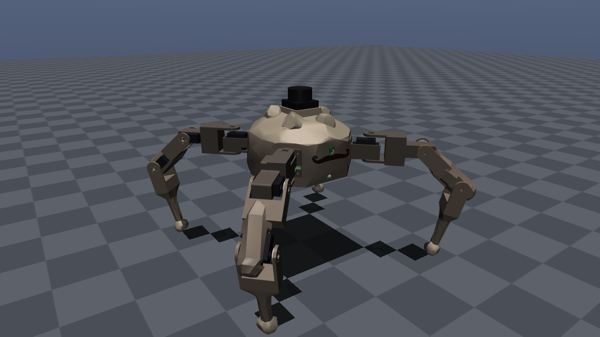
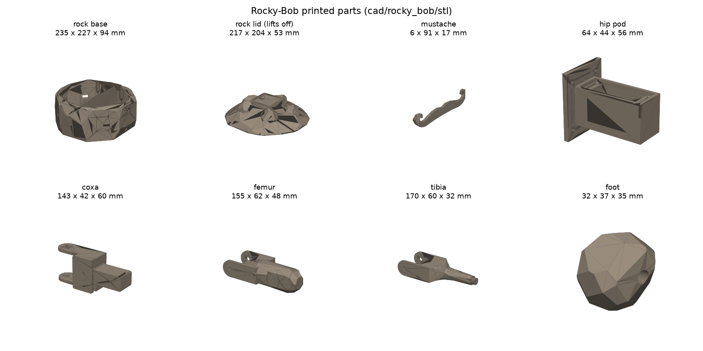
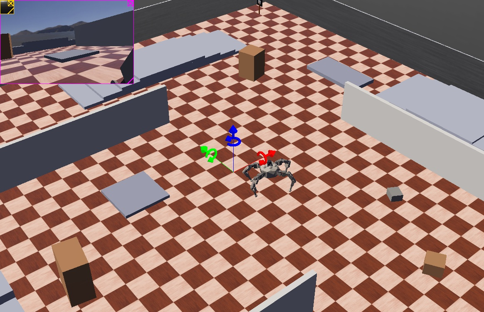
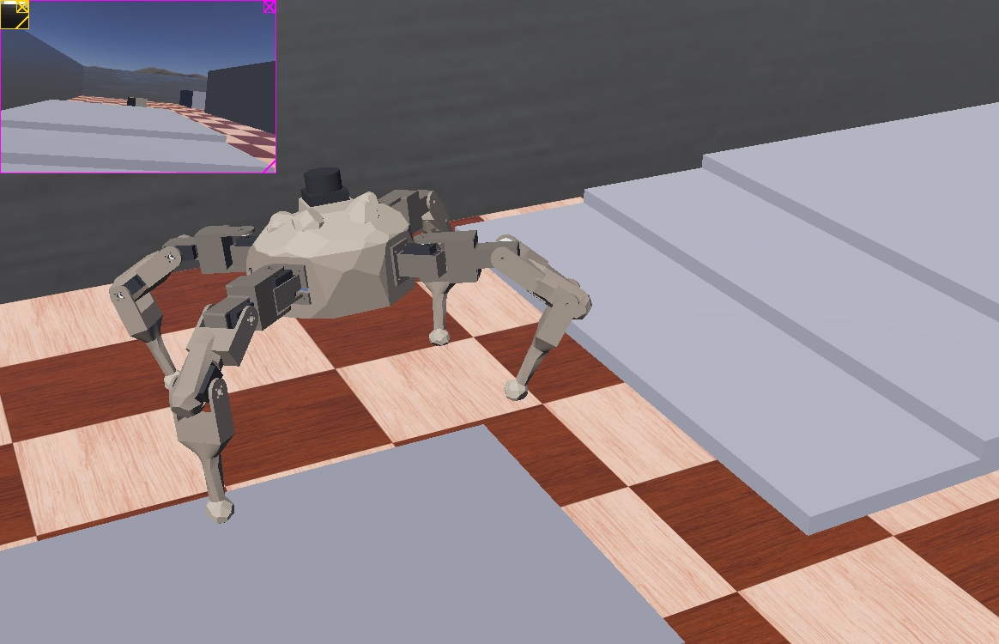
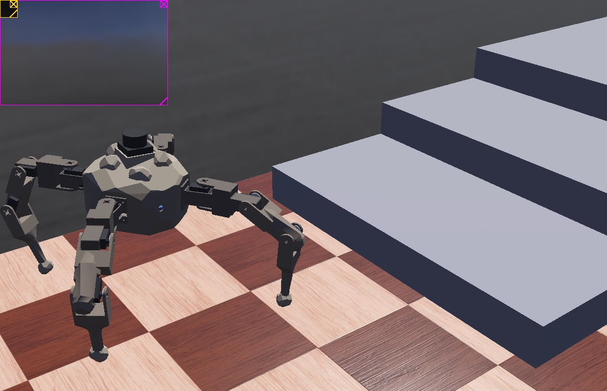
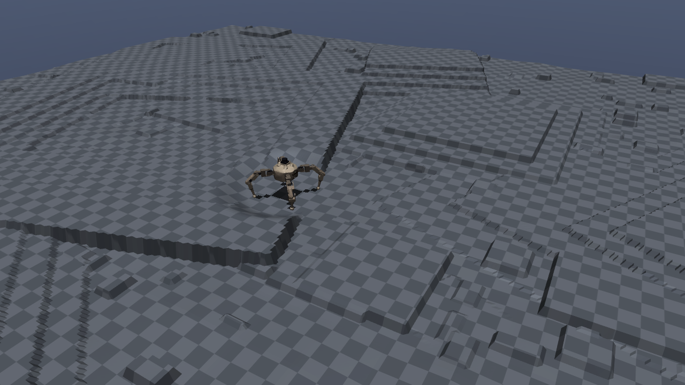

# Bob

Bob is a general-purpose autonomous robot: one **central identity** (his skills, memory and way of getting things done) that can be loaded into different robot bodies to complete tasks. **Rocky-Bob** is the first body, a four-legged walker. This repository holds that body, its simulators and the learned skills that drive it, built on ROS 2 Humble, MuJoCo and Webots.



## Rocky-Bob

A low-poly boulder on four 3-joint legs, styled after Rocky from *Project Hail Mary*, with a lidar "top hat" and a mustache to match. The top lifts off like a crab's shell to reach the electronics.

| Part | What it is |
| --- | --- |
| Brain | Raspberry Pi 5 |
| Servo driver | Pimoroni Servo 2040 |
| Joints | 12 HobbyPark 25 kg coreless servos (3 per leg) |
| Eyes | Raspberry Pi Camera Module 3 (nose), RPLIDAR C1 360° lidar (top), SparkFun VL53L5CX 8x8 ToF floor sensor (nose, tilted down) |
| Still to add | An IMU (e.g. BNO085; the sim already assumes one) and foot contact sensors (FSR 402s). The servos don't report their angle, so the walker will need to run open-loop or get feedback servos. |



The CAD is in `cad/rocky_bob/` (CadQuery, `build.py` regenerates the STL/STEP files, the URDF and the Webots robot). See `cad/rocky_bob/README.md`.

### What he can do (in simulation)

- **Walk, turn and run** with a learned walking policy: about 0.3 m/s, turning on the spot at about 0.8 rad/s.
- **Climb stairs** of 2-5 cm (88% of the stair test). He's training on 6-10 cm steps and 12-30 cm ledges, but can't do those yet.
- **Get back up** after falling on his back or side (88% of falls), gently on the lidar.
- **Navigate** to a target he spots with his camera, round walls and boxes with the lidar, searching when it's out of sight.
- **Chase mode**: a second Bob collects prizes while the first hunts him.

| Webots arena | Climbing the 3 cm stairs | At the 10 cm stairs (still learning) |
| --- | --- | --- |
|  |  |  |

The skills are trained with reinforcement learning (PPO) in MuJoCo, on rough terrain, stairs and ledges like this:



How the training works, the policies and their scores are in [`rl/README.md`](rl/README.md). Nothing has run on the real robot yet.

## Quick start: simulation

You need Docker Desktop and Webots R2025a. Then, from the repo root:

```bash
scripts/start_sim.sh --nav planner
```

The script starts Docker if needed, opens Webots with the Rocky-Bob world, builds and starts the `bob-sim` ROS 2 container (the first run takes a while), and connects the bridge to the 12 motors. With `--nav planner` Bob walks to the orange target post: drag it around in Webots.

**Demos:** click the Webots 3D view and press **1** tour, **2** stairs, **3** flip, **4** walls, **5** tall stairs, **6** ledge, **0** all, **S** stop. Or run `scripts/demo.sh`.

Other options:

- `--world chase` opens chase mode (a second Bob), then press **7**.
- `--policy rl/policies/rocky_walk.npz` runs just the walker: drive it with `/cmd_vel`.
- `--world cad` loads the older CAD-derived Bob model.
- `--stop` shuts the container down.

ROS commands run inside the container with `scripts/sim_ros.sh`, for example `scripts/sim_ros.sh ros2 topic echo /nav/status`. To train more on this machine: `scripts/train_more.sh --hours 3` (`--status` to check, `--stop` to finish early).

The Docker setup lives in `docker/`. The colcon build is kept in a Docker volume, so the repo's `build/` and `install/` folders are left alone.

Images: `rl/render_images.py` redraws the CAD and MuJoCo pictures. The Webots ones come from the bridge's `/screenshot` topic (`path;eye x,y,z;look-at x,y,z`).

## Running on Windows

Everything runs on Windows 10/11 too: Webots and MuJoCo natively, ROS 2 in Docker Desktop. Docker runs the x86 sim image natively there, where the Mac emulates it. In PowerShell:

```powershell
git clone https://github.com/Arkrez/bob.git
cd bob
powershell -ExecutionPolicy Bypass -File scripts\setup_windows.ps1
```

`setup_windows.ps1` installs Git, Python 3.12, Docker Desktop and Webots R2025a with `winget` if they're missing. It then sets up `rl\.venv` from `rl/requirements.txt` and builds the sim container. If Docker Desktop asks you to enable WSL 2, restart or sign in, do that and run the script again. If Windows Firewall asks about Webots, allow it on private networks: the container connects to it.

Then use the PowerShell twins of the Mac scripts (run each with `powershell -ExecutionPolicy Bypass -File`, or allow local scripts once with `Set-ExecutionPolicy -Scope CurrentUser RemoteSigned`):

| | macOS / Linux | Windows |
| --- | --- | --- |
| start the sim (planner navigation) | `scripts/start_sim.sh --nav planner` | `scripts\start_sim.ps1 -Nav planner` |
| stop it | `scripts/start_sim.sh --stop` | `scripts\start_sim.ps1 -Stop` |
| ROS commands in the container | `scripts/sim_ros.sh ros2 topic list` | `scripts\sim_ros.ps1 ros2 topic list` |
| demos | `scripts/demo.sh` | `scripts\demo.ps1` |
| train more | `scripts/train_more.sh --hours 3` | `scripts\train_more.ps1 -Hours 3` |
| MuJoCo viewer | `rl/.venv/bin/mjpython rl/watch.py ...` | `rl\.venv\Scripts\python rl\watch.py ...` |

On a fresh clone, training starts from the walkers in `rl/policies/`. The training state (`rl/runs/`, champions and checkpoints) stays on the machine that made it.

## The older CAD model

The sections below are about the first Bob CAD model (`webots_quadruped/`, `src/`), from before Rocky-Bob. Its ROS 2 controller drives the motors by joint angle; Rocky-Bob's learned policies use the bridge in `webots_quadruped/controllers/bob_ros2_external.py` directly.

### Files

- `webots_quadruped/protos/Bob.proto`: Webots PROTO; the model references `../meshes/*.stl` relative to the PROTO.
- `webots_quadruped/meshes/`: 17 meshes for the current Bob chassis and four legs.
- `webots_quadruped/worlds/bob.wbt`: world that instantiates `Bob` (not an older robot definition).
- `src/bob_description/urdf/robot.xacro`: maintainable ROS 2 description with reusable leg macro.
- `src/bob_description/urdf/robot.urdf`: expanded URDF, usable without Xacro processing.
- `src/bob_description/meshes/`: same mesh blobs packaged for `package://bob_description/meshes/...` lookup.

#### Webots

Open `webots_quadruped/worlds/bob.wbt` in Webots. The `Bob.proto` file uses an external controller (`<extern>`), which must be connected for motor control. Webots resolves the STL mesh URLs relative to `webots_quadruped/protos/Bob.proto`.

#### ROS 2

From the repository root inside a ROS 2 Humble environment:

```bash
source /opt/ros/humble/setup.bash
colcon build --symlink-install --packages-select bob_description
source install/setup.bash
ros2 pkg prefix bob_description
xacro src/bob_description/urdf/robot.xacro > /tmp/bob.urdf
```

The existing locomotion and servo bridge code remains under `src/quadruped_control/` for compatibility with existing commands. **Its older leg ordering/joint nomenclature and IK axes are not yet validated against the new 12-joint CAD model.** Do not command the physical robot using these new model coordinates until they have been checked.

#### Important CAD assumptions

Joint anchors are approximated from STEP geometry; hip joint axes are Z and the two downstream axes are Y. Limits are placeholder ±90 degrees; masses, collision geometry, and motor torques are provisional. The CAD rest pose may not be a standing pose. Confirm motion, collisions, inertia and hardware servo mapping before locomotion tests.

### ROS 2 -> Webots direct motor bridge (Bob CAD)

The existing ROS 2 controller publishes twelve angles (radians) on
`/leg_position_controller/commands`, with joint order `J1,J3,J4` for
each leg index 0–3. The Webots external bridge subscribes to this topic
and applies positions to twelve `RotationalMotor` devices.
Motor positions are published to `/joint_states`.

The Webots and URDF joint names are `joint1_leg0`, `joint3_leg0`,
`joint4_leg0` through leg 3.

#### On a Mac with Webots GUI and ROS 2 Humble in Docker

1. Open `webots_quadruped/worlds/bob.wbt` in Webots and run the simulation.
2. In the ROS 2 container, mount the Bob repo to `/workspace`.
   Ensure `rclpy`, `sensor_msgs`, `std_msgs`, Webots Python controller
   runtime, `orocos-kdl`, `cv_bridge` and `xacro` are available.
3. Build:

   ```bash
   source /opt/ros/humble/setup.bash
   cd /workspace
   colcon build --symlink-install --packages-select bob_description quadruped_control --cmake-args -DBUILD_TESTING=OFF
   source install/setup.bash
   ```

4. Launch the ROS controller, explicitly disabling physical servo writes:

   ```bash
   ros2 run quadruped_control quadruped --ros-args -p enable_servo_bridge:=false
   ```

5. In another ROS 2 terminal (inside Docker), start the Webots external
   controller via the installed `webots-controller` launcher:

   ```bash
   webots-controller --protocol=tcp --ip-address=host.docker.internal --port=1234 --robot-name=Bob /workspace/webots_quadruped/controllers/bob_ros2_external.py
   ```

   Check `which webots-controller` first. Webots controller runtime and a
   Python interpreter able to import both `controller` and `rclpy` are
   required inside the container. If necessary, enable remote controller
   connections in Webots Preferences > Network.

6. Confirm connection and move one joint:

   ```bash
   ros2 topic info /leg_position_controller/commands
   ros2 topic echo /joint_states
   ros2 topic pub --once /set_angles std_msgs/msg/String "{data: '0,0,10,0'}"
   ```

   `/leg_position_controller/commands` should show at least one subscriber
   and `/joint_states` should report twelve positions. You may also send
   a 12-radian array directly:

   ```bash
   ros2 topic pub --once /leg_position_controller/commands std_msgs/msg/Float64MultiArray "{data: [0,0.2,0, 0,0,0, 0,0,0, 0,0,0]}"
   ```

7. After verifying individual joints move, run the small-amplitude
   **motion smoke test** (not a stable gait):

   ```bash
   python3 /workspace/webots_quadruped/scripts/joint_motion_demo.py
   ```

#### Calibration and safety

The previous API remains: `/set_angles` expects
`leg,J1,J3,J4` in degrees and `/ik_target` uses inches in the body
frame. The IK chain now uses STEP-derived hip/pivot positions and Y-axis
downstream rotation, but its **foot tip length is still estimated**.
Verify signs, end-effector offsets, gait, inertia and collision contact
before any walking tests. The physical servo bridge is off in the
simulation command above; do not run the demo on physical hardware.

The CAD leg geometry positions are not yet independently matched to the
old logical labels (FL/FR/BL/BR), so confirm leg indexing by moving
one joint at a time. The external bridge deliberately bypasses
`controller_manager` / `ros2_control` while keeping the existing
position-command topic.

#### Troubleshooting

If the controller reports no subscriber on
`/leg_position_controller/commands`, the Webots external bridge is not
connected. Confirm `--robot-name=Bob`, the Webots TCP port, Docker host
reachability, and that the controller's Python can import `rclpy` and
`controller`.
