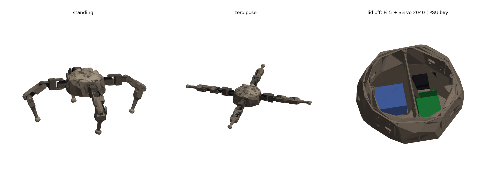

# Rocky-Bob

Bob, rebuilt to look like Rocky from *Project Hail Mary*. The body is a hollow, low-poly boulder with lumps on top and a flat base, so it can sit on the ground. Four craggy MG995 legs radiate out from it. The top lifts off like a crab's shell so you can reach the electronics.



## Generating the files

All the geometry is parametric: `leg.py` defines the leg and `body.py` defines the rock. Edit a value at the top of either file and re-run:

```bash
pip install cadquery
python build.py
```

| Output | Use |
| --- | --- |
| `step/rocky_bob_assembly.step` | Open in Fusion 360. The whole robot in the zero pose, coloured, with dummy servos, boards and PSU. |
| `step/rocky_bob_standing.step` | The same robot in a standing pose. |
| `step/<part>.step`, `stl/<part>.stl` | Printed parts. Print `rock_base` and `rock_lid` once each. Print `hip_pod`, `coxa`, `femur`, `tibia` and `foot` four times each. |
| `sim/rocky_bob.urdf` | The full robot: `base_link`, then `leg0`–`leg3`, with joints `joint1/3/4_legN`. Inertials are computed from the CAD. |
| `sim/protos/RockyBob.proto`, `sim/worlds/rocky_bob.wbt` | Webots version. It uses an `<extern>` controller, the robot is named `Bob`, and the motor names match `controllers/bob_ros2_external.py`. Each foot has a `legN_foot` touch sensor. |

## The rock

- **Size:** the base is 248 × 227 mm, so it fits a 256 mm print bed. The whole rock is about 150 mm tall.
- **Shape:** the rock is a convex shape made from many flat faces. Each leg bolts to one of those faces, and because the shape is convex, a leg can never swing into the shell.
- **Look:** the shape comes from `RX/RY/RZ`, `FACETS`, `ROUGHNESS` and `SEED`. Change `SEED` to get a different rock, and `LUMP_SEEDS` to get different lumps.
- **Lid:** the lid splits off at `Z_SPLIT` = 88 mm. A 6 mm lip on the base locates it. Four 6 × 3 mm disc magnets hold it on: one in each post on the base and one in each boss inside the lid. Check the magnet polarity before gluing them in.
- **Leg pads:** each pad has 4 × M3 clearance holes with nut traps on the inside, plus a slot for the servo wires.

## Inside

- **Front half (+X):** electronics.
  - Raspberry Pi 5 on four standoffs, with its ports facing the side wall.
  - Pimoroni Servo 2040 on four standoffs.
  - A Raspberry Pi Camera Module 3 behind a flat window on the nose, 70 mm up. It has a 14 mm lens hole and four M2 standoffs on the board's 21 × 12.5 mm pattern. Check the hole and lens positions against your board; the values are in `body.py` (`CAM_*`). The ribbon runs back to the Pi's camera connector.
  - Both boards use **M2.5** screws, not M3, because their holes are 2.7 mm. The standoffs have 2.2 mm pilot holes.
- **Divider:** a wall splits the two halves. A 40 × 22 mm notch at its base lets cables through.
- **Back half (−X):** power-supply bay.
  - Four L-shaped corner guides and two loops for a 20 mm velcro strap.
  - A 12 mm hole in the back wall for a panel-mount switch.
  - The PSU is a placeholder (80 × 60 × 40 mm, 250 g). When you have the real one, set `PSU_L`, `PSU_W`, `PSU_H` and `PSU_MASS` in `body.py` and re-run `build.py`. The guides, strap loops, assembly and sim mass all update.

## Legs

The kinematics are the same as Bob's current CAD model, so the existing controller topics still apply:

- hip yaw (`joint1`, Z axis)
- 107.2 mm to hip pitch (`joint3`, Y axis)
- 107.2 mm to the knee (`joint4`, Y axis)
- 160 mm to the foot

Each leg points straight out from its corner at 225°, 135°, 45° and −45° (leg0–leg3). The hip axis is 60 mm above the base. A positive pitch swings the leg down. With `joint3 = 0.6` and `joint4 = 1.3` rad, the body stands about 135 mm off the ground. In the sim, the robot starts resting on its flat base.

Hardware for each joint:

- 4 × M3 × 12 through the servo tabs, self-tapping into 2.6 mm pilot holes
- 4 × M3 × 8 through the cheek into the horn
- 1 × M3 × 10 pivot screw on the side opposite the horn, with a trapped nyloc nut

Each hip pod bolts to its pad with 4 × M3 × 12 and nuts. The pebble foot (TPU) fastens with an M3 × 25 into the shin.

## Checked

- Every part is a single valid solid.
- The servos, boards and PSU placeholder fit without overlapping anything.
- The pad holes line up with the hip pod holes.
- The legs stay clear of the rock with each joint at ±80°.
- Neighbouring legs stay clear of each other in the zero and standing poses.

## Not checked

- The files have not been opened in Fusion or Webots.
- The MG995 and horn dimensions come from the datasheet. Measure your parts and update the values in `leg.py`.
- The robot weighs about 2.3 kg with the placeholder PSU, which is a lot for MG995s. Check that the hip-pitch servos can hold the stance before trusting the gait.

## Printing

- Print the base floor-down. It needs no supports except for small bridges at the strap loops.
- Print the lid dome-up with tree supports inside.
